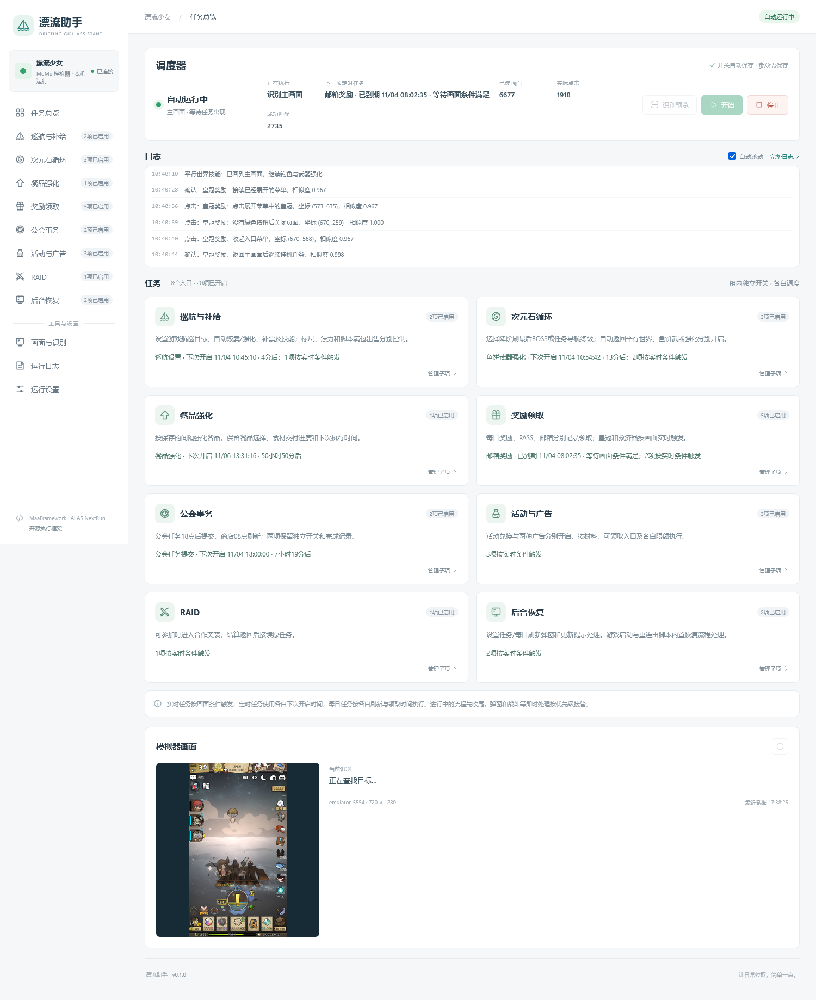
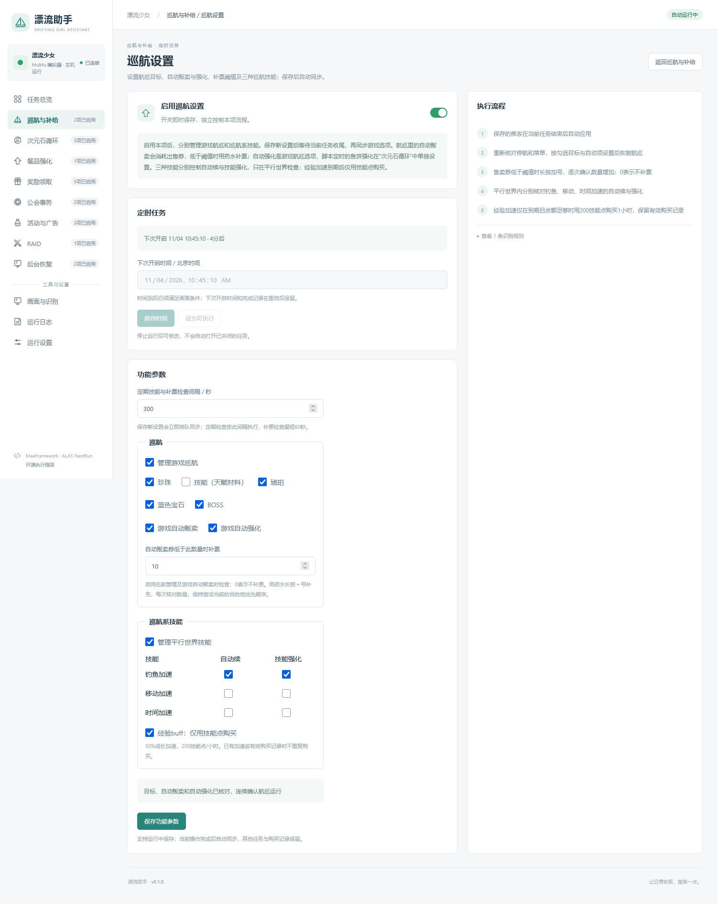
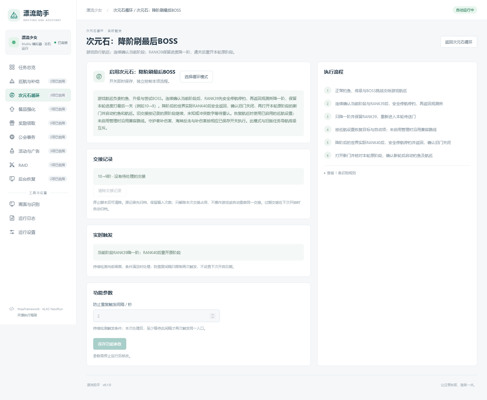
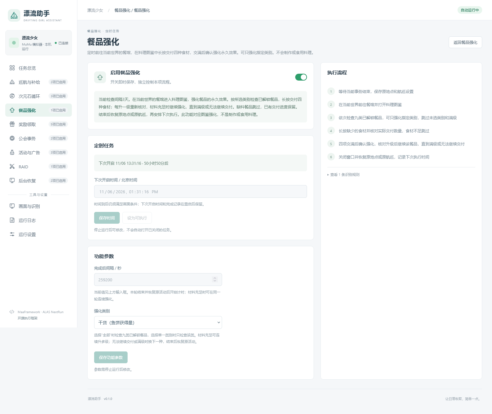

# 漂流助手 · Drifting Girl Assistant

**把重复操作交给调度器，把时间留给自己。**

漂流助手是一款带网页控制台的《漂流少女》自动化助手，为长时间挂机与定时日常设计。航巡、次元石循环、标尺校准、武器与餐品强化、公会和收奖任务集中管理，减少反复开菜单和盯屏幕的时间。

正常推进沿用游戏内的自动航巡，助手负责参数同步、关键阶段交接和定时任务。项目基于 MuMu 模拟器、MaaFramework 执行引擎及 ALAS 风格的图片匹配与 NextRun 调度，免费开源，欢迎学习和交流。

**首个公开预览版本：v0.1.0 · Windows x64 · 简体中文游戏界面 · 720×1280 竖屏。**

[使用说明](USER-GUIDE.md) · [图文介绍](docs/INTRO.md) · [源码运行与构建](docs/DEVELOPMENT.md) · [更新记录](CHANGELOG.md)

截图来自功能快照，勾选和参数属于演示示例。发布配置的所有任务默认关闭，需要在面板中自行选择。

## 下载与启动

在本项目 GitHub 页面右侧的 **Releases** 中下载 `mumu-clicker-0.1.0-win64.zip`。普通使用者下载便携包即可，GitHub 自动生成的 Source code 压缩包用于开发，不含可执行程序。

1. 完整解压到可写文件夹，进入 `mumu-clicker` 子目录。
2. 在 `config.json` 中填写本机 MuMu 的 `adb_path` 和正确的 `serial`。保留 720×1280 分辨率。
3. 打开 MuMu 与游戏，双击 `启动.cmd`，浏览器访问 `http://127.0.0.1:8765/`。
4. 确认任务参数和资源消耗选项，勾选需要的功能，再点击“开始”。

便携版自带 Python 运行时，不需要另装 Python 或 Git。需要本机具备兼容的 Microsoft Visual C++ x64 运行库。详细配置与排错见[使用说明](USER-GUIDE.md)。

## 八组功能

| 分组 | 功能 |
| --- | --- |
| 巡航与补给 | 珍珠、天赋材料、琥珀、蓝色宝石、BOSS 五类目标；游戏自动贩卖/强化；出售券补充；三种巡航技能；标尺校准、法力和脚本满包出售 |
| 次元石循环 | 从当前阶段在 RANK39 安全返回、降一阶刷最后 BOSS；低一阶实际 RANK40 后返回并重开原阶段；可选旧任务导航练级、返回平行世界、鱼饼武器强化 |
| 餐品强化 | 在料理图鉴提交四种食材，强化永久效果；可选类别，缺料或满级跳过，与制作、食用料理区分 |
| 奖励领取 | 每日、附赠、PASS、邮箱、皇冠及救济品，分别识别状态并保留记录 |
| 公会事务 | 每天北京时间18:00提交紫色、蓝色任务；商店商品独立开关 |
| 活动与广告 | 活动药水兑换、成长广告、药水广告分别控制 |
| RAID | 进入、准备、场内抛竿、战斗和结算返回 |
| 后台恢复 | 任务/每日刷新/更新弹窗处理；游戏启动及重连接回已有流程 |

查看巡航设置、次元石循环和餐品强化界面

### 巡航与技能

目标、自动贩卖、补票阈值和技能选项集中设置，在安全交接后同步到游戏。

### 次元石循环

管理降阶、返回与下一轮交接，并将鱼饼武器强化放在同一分组。

### 餐品强化

选择类别与执行间隔，在料理图鉴交付食材，强化餐品的永久效果。

## 调度与参数

- **实时任务**根据当前画面及条件触发；**定时任务**保留各自的下次执行时间；**每日任务**按北京时间刷新和完成记录执行。
- 航巡与技能选项支持运行中保存，在安全交接后同步到游戏。设备路径和实例修改需要先退出面板服务。
- 发布示例中，武器强化每15分钟检查，每种可强化武器长按12秒；餐品每三天检查一次。
- 标尺在角色等级比标尺高出**超过80级**且冷却结束时触发，目标为当前可用范围内的角色附近，允许10级误差，不要求 MAX。流程保留航巡，只在明确的普通鱼准备阶段停持续钓鱼。
- 经验加速只允许使用技能点；其有效期和购买记录单独保存。脚本不使用钻石兑换。

## 发布默认值

所有任务、自动返回平行世界均关闭。巡航页预选珍珠、琥珀、蓝色宝石、BOSS；游戏自动贩卖、自动强化、出售券自动购买和技能消耗选项默认关闭。补票阈值为0，表示不自动补票。按自己的账号资源和用途调整后再开启。

`config.example.json` 是随源码维护的发布模板；`config.json` 是本机配置，被 Git 忽略。启动脚本只会在配置缺失时复制模板，不覆盖已有设置。发布打包工具始终从模板生成包内配置，不读取开发机运行记录。

## 支持范围

本预览版的模板与流程按 MuMu、简体中文界面和 720×1280 竖屏验证。其他模拟器、语言、分辨率或游戏改版可能需要重新适配。未知画面会等待、保留进度或停止，不能把进程在线、AUTO 箭头、输入次数当作钓鱼或通关成功。

正常推进主要由游戏内航巡负责。助手按新截图处理菜单和阶段交接；停止后请等待面板显示已停止，再手动接管游戏。请保留运行目录内的状态、购买和调度记录，更新时按[迁移说明](USER-GUIDE.md#更新版本)处理。

## ⚠️ 免责声明

本项目是面向《漂流少女》的**非官方开源自动化工具**，用于学习图像识别、界面自动化与任务调度，以及减少重复操作。项目免费提供，不属于游戏或模拟器的官方产品；对 ALAS、MaaFramework 等开源组件的使用不代表获得其官方背书。

程序通过模拟器截图识别和模拟触控与游戏界面交互，不以修改游戏客户端、游戏内存或网络通信数据实现功能。采用这种交互方式**不等于获得游戏运营方许可**；自动化是否被允许，应以适用的游戏协议和运营规则为准。

自动化操作可能带来账号限制或处罚；游戏更新、界面变化和识别异常也可能导致误操作、资源消耗、任务中断或进度损失。请在了解相关规则和功能消耗后自行决定是否使用，并备份自己的配置与运行记录。

本软件按 **GPL-3.0** 许可分发，并按“现状”提供。使用、修改、分发的条件，以及担保与责任范围，以 [LICENSE](LICENSE) 和适用法律为准。游戏名称、界面图像和图标的权利归各自权利人所有。

> **启用自动化前，请确认自己理解相关功能、资源消耗和账号风险；首次使用时请观察实际效果。**

## 开发

运行依赖固定在 `requirements.txt`，构建依赖固定在 `requirements-build.txt`。源码运行、离线测试及构建步骤见[开发文档](docs/DEVELOPMENT.md)。测试使用本地样例和模拟设备；发布检查不会连接模拟器或输入游戏。

## 许可与来源

代码沿用 **GPL-3.0**，见 [LICENSE](LICENSE)。包含改编的 [AzurLaneAutoScript](https://github.com/LmeSzinc/AzurLaneAutoScript) 基础组件，执行引擎为 [MaaFramework](https://github.com/MaaXYZ/MaaFramework)。固定版本、改动范围及模型来源见 [THIRD_PARTY_NOTICES.md](THIRD_PARTY_NOTICES.md)，发行依赖的许可文本在 `licenses/`。

游戏名称、界面图像和图标属于其各自权利人。图像用于游戏界面识别与功能说明；本项目不是游戏、MuMu、ALAS 或 MaaFramework 的官方发行版，不包含游戏安装包或 MuMu SDK DLL。
