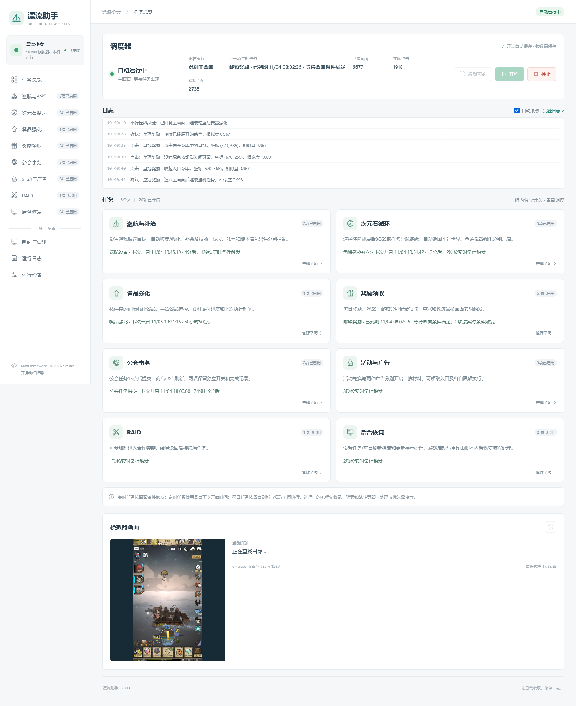
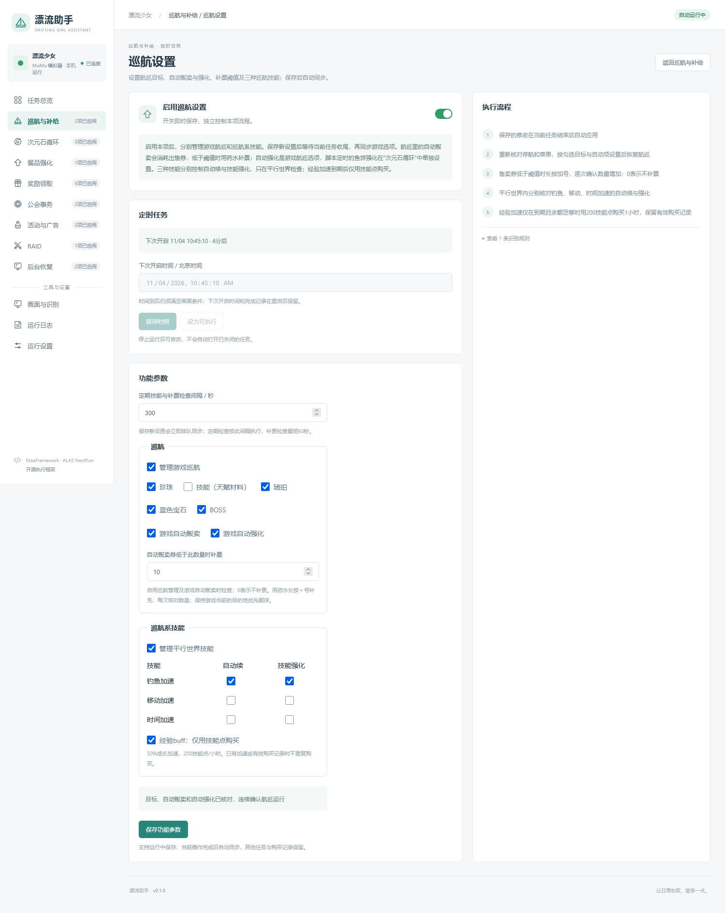
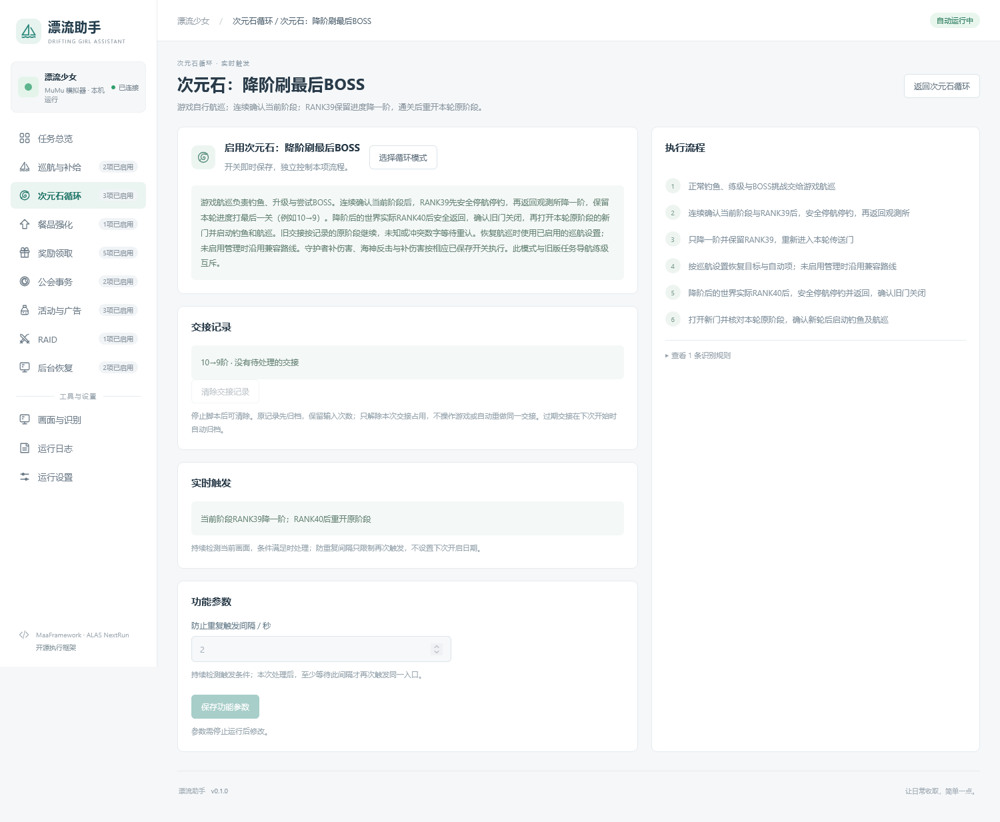
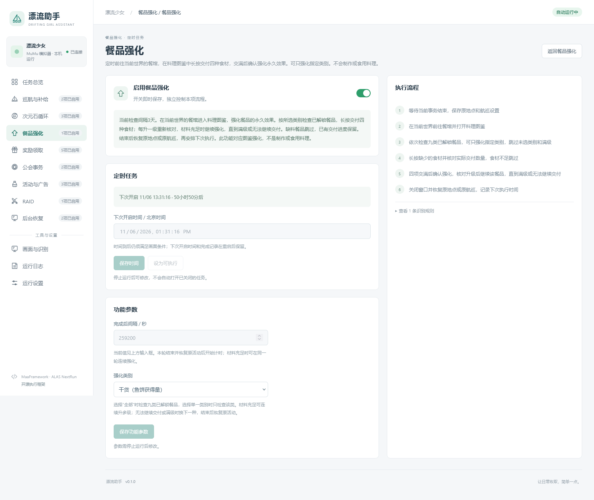

# 漂流助手图文介绍

用同一张网页控制台，管理游戏航巡、阶段交接与定时日常。

以下界面来自2026年11月4日的功能快照。截图展示运行中的示例设置；发布模板的所有任务默认关闭，需按自己的账号和资源选择。界面展示不能替代实机运行或完整循环验证。

## 控制台：看到任务在做什么

任务按八组集中管理。调度器展示当前动作、下次定时任务和日志；定时任务保留各自的下次执行时间，实时任务根据当前画面触发。

## 巡航：目标、补给和技能一起设置

珍珠、天赋材料、琥珀、蓝色宝石、BOSS 分别勾选。游戏自动贩卖与自动强化独立选择，补票阈值为0时不购买出售券。

钓鱼、移动、时间加速分别设置自动续和技能强化。经验加速仅使用技能点购买，并保留有效期与购买记录。保存后由脚本在安全交接时同步，无需逐项手动打开游戏菜单。

## 次元石：接续阶段变化

按当前设置处理 RANK39 降阶、低一阶最后 BOSS、返回与下一轮启动。正常推进沿用游戏内航巡，助手负责交接；鱼饼武器强化在同一分组中设置。

标尺校准作为独立实时任务，在满足差距和冷却条件后触发，保留已有运行记录。

## 餐品：强化永久效果

在料理图鉴中为已解锁餐品交付四种食材，材料充足时可继续强化，缺料或满级则跳过。可以选择餐品类别及执行间隔，交付进度和下次执行时间单独保存。

这项功能强化餐品的永久效果，不制作或食用料理。

## 日常与恢复

奖励、公会、活动、广告和 RAID 各自控制开关与完成记录。后台恢复处理已识别弹窗与游戏重连，并接回未完成流程。首次使用时请观察实际动作，配置与迁移方法见[使用说明](../USER-GUIDE.md)。

项目定位、许可及风险说明见[README 免责声明](../README.md#️-免责声明)。
